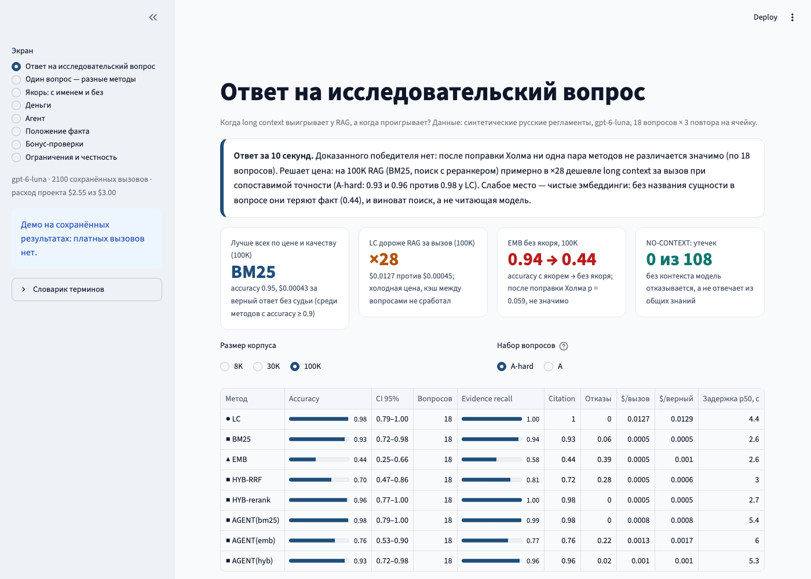
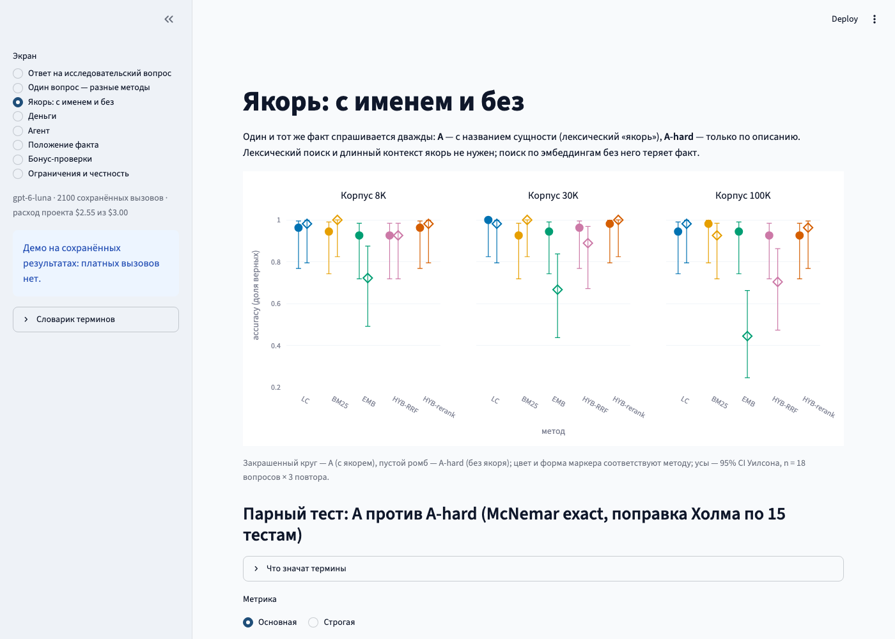
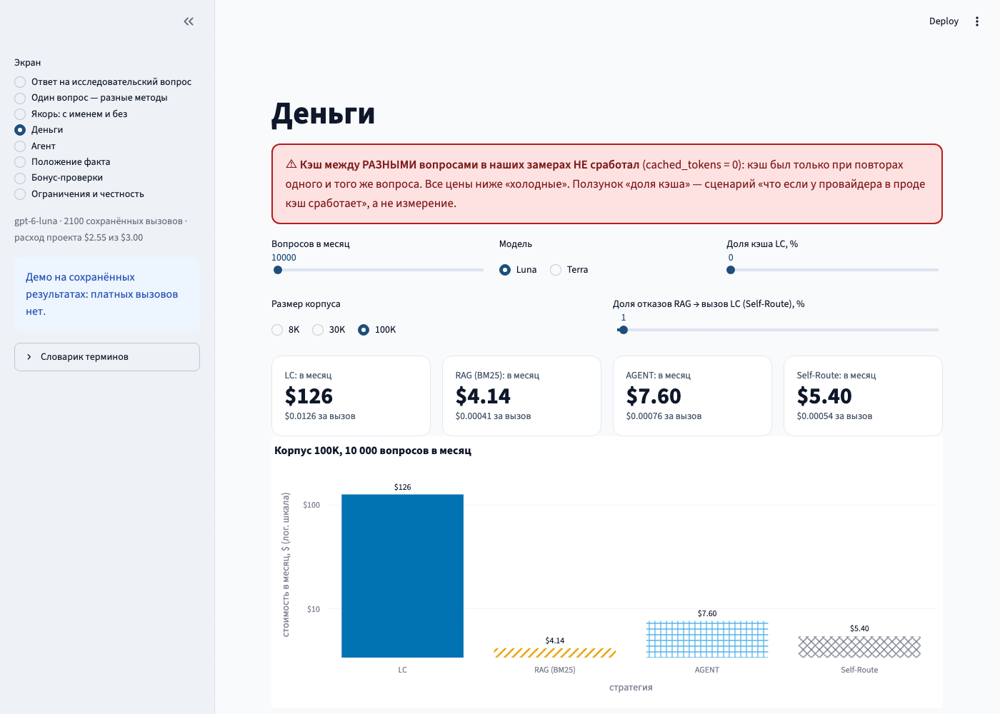

# Long Context vs RAG

Бенчмарк R04 (Document AI, KBTU X-DAI): **при каких объёмах документов и типах вопросов передача
всего корпуса в контекст (long context) выигрывает у retrieval-подходов (RAG), и наоборот**.
Сравнение честное по конструкции: один и тот же промпт, одна и та же модель, одна и та же
судейская проверка для всех методов — различается только то, как собирается `{context}`.

## Зачем это

Для продукта, который отвечает на вопросы по корпусу внутренних документов, есть два базовых
решения: закинуть всё в контекст большой модели или построить поиск (лексический, по
эмбеддингам, гибридный) и передавать модели только релевантные фрагменты. У каждого решения своя
экономика и свои слабые места — это не очевидно заранее и сильно зависит от размера корпуса и
типа вопроса. Бенчмарк отвечает на вопрос цифрами, а не интуицией: accuracy, $/correct, latency и
точные retrieval-метрики (evidence recall, citation correctness) на одном наборе контролируемых
вопросов.

## Как устроен эксперимент

**Корпус.** 48 синтетических «Положений» вымышленного университета (`corpus/raw/SOURCES.md`) —
без лицензионных ограничений и без реальных персональных данных, но написаны в стиле реальных
нормативных актов и намеренно пересекаются по формулировкам, чтобы поиск сталкивался с
реалистичной неоднозначностью. Собираются в три вложенных среза — **8K ⊂ 30K ⊂ 100K** токенов —
так что один и тот же вопрос можно задать на разных объёмах корпуса, и разница в ответе объясняется
только объёмом, а не разным текстом.

**Контролируемые факты.** В корпус вручную внедряются утверждения с заранее известным значением,
документом, чанком и позицией (`src/plant_facts.py` → `data/gold.json`). Это значит, что
evidence recall и citation correctness считаются **точным совпадением**, а не LLM-оценкой; судья
нужен только для одной метрики — совпадает ли смысл текстового ответа с эталоном, — и сам
калиброван на ручной выборке (см. `REPORT.md`).

**Наборы вопросов.**
| Набор | Что проверяет |
|---|---|
| **A** | вопросы с лексическим «якорем» — уникальный термин совпадает дословно с текстом корпуса |
| **A-hard** | те же вопросы, но без якоря — нужно сопоставить смысл, не строку |
| **B** | более широкий независимый набор (42 вопроса, 100K, другая проверка) |
| **NO-CONTEXT** | контрольная проверка на утечку: вопрос без корпуса вообще — модель обязана отказаться |

Каждый вопрос — одного из трёх типов: **T1** простой факт, **T2** сравнение двух документов,
**T3** поиск противоречий между документами.

**Методы.** Один и тот же промпт и модель для всех вариантов `{context}` (`src/answer.py`,
`src/methods/`):
- **LC** — весь корпус целиком;
- **BM25** — лексический поиск (`rank_bm25`) топ-k чанков;
- **EMB** — поиск по эмбеддингам (`text-embedding-3-small`);
- **HYB-RRF** — гибрид BM25+эмбеддинги (Reciprocal Rank Fusion);
- **HYB-rerank** — то же плюс кросс-энкодер (`bge-reranker-v2-m3`);
- **AGENT** — модели не передают готовый контекст, а дают инструменты (`search_corpus`,
  `get_chunk`, `compute`, запись в Notion-мок) и дают самой искать нужное (`src/methods/agent.py`);
- **NO-CONTEXT** — пустой контекст, контроль утечки.

Постфактум-варианты (после основных прогонов, отдельно от главной таблицы): `emb_bge` — эмбеддинги bge-m3 вместо
text-embedding-3-small; `bm25_doc`, `hyb_rerank_doc` — чанки в порядке документа (OP-RAG); читатель `gpt-6.1-terra`
на тех же найденных фрагментах; Self-Route и роутер по типу вопроса — симуляция по сохранённым ответам.

**Модели.** Ответы и судья — `gpt-6-luna` (у `gpt-6-*` нет датированного снапшота, id пишется как есть; в логе есть `model_api`);
эмбеддинги — `text-embedding-3-small` (OpenAI), в проверке — `BAAI/bge-m3` локально; реранкер — `BAAI/bge-reranker-v2-m3` локально;
для отладки — локальная `qwen2.5-7b-32k` (Ollama), в финальные числа не входит.

**Метрики:** accuracy (судья + проверка значения в ответе), evidence recall, citation
correctness, quote groundedness, latency (p50/p95), $/correct, доля отказов. Доверительные
интервалы — Уилсон 95% по числу **уникальных вопросов**, не по числу вызовов (повторы одного
вопроса не независимы). Значимость различий между методами — точный тест Макнемара с поправкой
Холма на множественные сравнения.

## Что получилось (коротко)

Полные цифры, гипотезы и оговорки — в [REPORT.md](REPORT.md) и [results/main_table_v2.md](results/main_table_v2.md).
Модель `gpt-6-luna`, по 18 вопросов × 3 повтора на ячейку (набор B — 42 вопроса × 1 повтор).

**Главное.** Статистически доказанного превосходства long context над RAG (или наоборот) нет ни на одном размере корпуса и ни на одном
типе вопроса: после поправки Холма ни одна пара методов не различается значимо (значимо лишь «любой метод лучше пустого контекста»).
На наборе **A** (с названием сущности в вопросе) все методы держат 0.93–1.00. Решает цена: на 100K один вызов LC в ×28 дороже RAG
(≈ $0.0127 против $0.00045), верный ответ — ≈ $0.013 против ≈ $0.0004. На **A-hard** (без названия, по описанию) на 100K: LC 0.98, BM25 0.93,
HYB-rerank 0.96, AGENT(bm25) 0.98, HYB-RRF 0.70, **EMB 0.44**. Контроль без контекста: 0 верных из 108, утечек нет.

**Ось якоря (A против A-hard, парный тест, постфактум).** Только у поиска по эмбеддингам заметна потеря без якоря: EMB 0.94 → 0.72 / 0.67 / 0.44
на 8K / 30K / 100K. Самый сильный результат (EMB, 100K: 9 вопросов верны только с якорем, 0 — только без) даёт p = 0.0039, но после Холма
**p = 0.059 — тенденция, не значимо**. При 18 парах тест способен подтвердить только очень большую разницу (≥ 0.33 без поправки, ≥ 0.56 с поправкой),
поэтому «не значимо» — это предел чувствительности, а не «различий нет».

**Постфактум-проверки (23 ноября, отдельно от главной таблицы).**
- `quote_grounded` была 0.1–0.3 из-за строгого сравнения строк (кавычки „…“, ссылки на пункты), после исправления формы цитаты ≈ **0.92**: это был артефакт, а не галлюцинации.
- EMB на bge-m3 вместо text-embedding-3-small: 100K 0.44 → 0.59 (не значимо), BM25 по-прежнему лучше (0.93) — провал не сводится к выбору эмбеддера.
- Читатель Terra на тех же найденных фрагментах не изменил ни одного вердикта: проблема в поиске, а не в читающей модели (Terra ≈ в 9 раз дороже за верный ответ).
- OP-RAG (порядок чанков как в документе): эффекта нет (все p = 1.0); побочно k = 16 вместо 8 поднимает BM25 с 0.93 до 1.00.
- Self-Route и роутер по типу — симуляция по сохранённым ответам: при хорошем поиске отказов 0–6%, выигрыша нет; у слабого EMB Self-Route поднимает 0.44 до 0.83, но BM25 дешевле и лучше.

Положение факта в контексте (P1) и ранг фрагмента в выдаче (P2): эффекта не обнаружено, но выборка мала (6–13 вопросов) и упирается в потолок —
это не доказательство отсутствия эффекта. Все числа предварительные: судья откалиброван на n = 40 одним проверяющим (не независимая двойная разметка).

## Структура репозитория

```
src/
  llm_client.py        единый клиент (openai | local), usage/cost/latency в каждом ответе
  answer.py             один промпт для всех методов
  methods/              LC, BM25, EMB, HYB-RRF, HYB-rerank, AGENT, NO-CONTEXT, Self-Route — только сборка {context}
  build_corpus.py, plant_facts.py, chunking.py, hard_set.py   сборка корпуса и контролируемых фактов
  eval/                 судья, точные метрики, агрегация, McNemar + Холм, позиционные эксперименты
  cost_guard.py, cache.py   жёсткий лимит бюджета + дисковый кэш ответов по хэшу промпта
configs/
  base.yaml             модели, цены, бюджет, сид
  style.yaml            цвет, маркер и штриховка метода (графики и демо)
  experiments/          конфиг на каждый прогон (что менять — здесь, не в коде)
data/                   gold.json (факты с известным ответом), questions.json
corpus/                 исходные документы (SOURCES.md) + собранные срезы 8K/30K/100K
results/                таблицы (*.csv/*.md), графики, парные тесты, бонус-проверки, диагностика, калибровка судьи
runs/                   сырые вызовы (raw.jsonl), счётчики бюджета, дисковый кэш (в git не хранится)
demo/                   Streamlit-демо на сохранённых результатах (8 экранов, без API-ключа)
docs/                   сценарий видео (DEMO_SCRIPT.md), скриншоты демо (img/)
scripts/                смета, проверка наборов, статистика, мощность теста, графики, сверка демо с results/, проверка ссылок
tests/                  pytest — кэш, бюджет, метрики, McNemar, сборка корпуса, бонус-методы; demo_smoke.py — проверка экранов демо
v1/                     архив первой итерации (gpt-4o), отдельные результаты
```

## Быстрый старт

```bash
git clone <repo-url> && cd long-context-vs-rag
python -m venv .venv && source .venv/bin/activate
pip install -r requirements.txt
cp .env.example .env            # по умолчанию LLM_BACKEND=local — ничего не стоит

python -m scripts.estimate_cost # смета в долларах до первого платного вызова (то же: make estimate)
pytest -q                       # тесты кэша, бюджета, метрик, McNemar
make smoke                      # проверка клиента на локальной модели (нужен запущенный Ollama с qwen2.5-7b-32k)
```

Часть тестов скачивает токенайзер из сети при первом запуске; без интернета они могут не пройти. Готовые таблицы и графики лежат в `results/`. Пересобрать их можно только при наличии сырых логов `runs/*/raw.jsonl` (в git они не хранятся — `.gitignore`;
на чистом клоне их нет, а повторные прогоны платные): `python -m scripts.build_main_table --v2`, `python -m scripts.mcnemar_v2`, `make charts`.
Демо (`demo/`) работает и без `runs/`: его данные лежат в `demo/data/`. Платные прогоны: `LLM_BACKEND=openai python -m src.eval.run --exp configs/experiments/<имя>.yaml`
(нужны `OPENAI_API_KEY` и `BUDGET_USD_LIMIT` в `.env`).

## Backend'ы

| `LLM_BACKEND` | Ответ / судья | Эмбеддинги | Когда |
|---|---|---|---|
| `local` | Ollama `qwen2.5-7b-32k` (контекст 32768, см. `Modelfile.qwen2.5-7b-32k`) | `BAAI/bge-m3` (`sentence-transformers`, локально) | вся отладка и черновые прогоны — бесплатно |
| `openai` | `gpt-6-luna` | `text-embedding-3-small` | зачётные прогоны, под `cost_guard` |

Для `openai` нужны `OPENAI_API_KEY` и `BUDGET_USD_LIMIT` в `.env`. Полные параметры моделей и
цены — `configs/base.yaml`.

## Воспроизводимость и бюджет

- Все параметры — в `configs/*.yaml`, ничего не захардкожено; `seed` фиксирован; версии моделей —
  полные идентификаторы с датой.
- Каждый вызов логируется построчно в `runs/<прогон>/raw.jsonl` (полный промпт, ответ, usage,
  latency, стоимость) — ни одна цифра в отчётах не взята «на глаз».
- Дисковый кэш ответов по хэшу (промпт + модель + параметры): повторный запуск после сбоя не
  тратит деньги повторно.
- `cost_guard` — жёсткий лимит из `.env`, со счётчиком в `runs/budget_v2.json`; при превышении
  платные вызовы падают с исключением, а не тихо перерасходуют бюджет.
- Бюджет V2: потрачено **$2.5520 из лимита $3.00** по счётчику (5538 вызовов); мягкий стоп $2.50 пройден на ≈ $0.05 (в коде он не принудительный,
  жёсткий лимит не достигнут). Из них бонус-проверки 23 ноября — $0.3036. Разбивка по шагам — [results/spend_summary.md](results/spend_summary.md).
  Ragas считался отдельно, мимо `cost_guard` (оценка $0.02–0.04).
- Зафиксированные зависимости — `requirements.lock.txt` (`pip freeze`).

## Демо-видео

▶ ССЫЛКА_НА_ВИДЕО

(3–5 минут: вопрос, устройство корпуса, пара вопросов с якорем и без, живой запуск, агент, результаты, выводы, ограничения.)

## Демо (Streamlit, на сохранённых результатах)

Восемь экранов на уже посчитанных числах, без API-ключа, без сети и без новых вызовов: ответ на исследовательский вопрос
(карточки, таблица, интерактивный график), один вопрос — разные методы, якорь (A против A-hard и парный тест), деньги
(калькулятор: ползунки, Luna/Terra, Self-Route, безубыточность), агент (пошаговая трассировка), положение факта,
бонус-проверки (помечены «постфактум»), ограничения. Графики интерактивные (plotly), таблицы выгружаются в CSV, термины
объяснены в сворачиваемом словарике.

```bash
python -m venv .venv-demo && source .venv-demo/bin/activate
pip install -r requirements-demo.txt
streamlit run demo/app.py
python tests/demo_smoke.py              # каждый экран рендерится без ошибок
python scripts/check_consistency.py     # числа демо совпадают с results/ (источник истины), REPORT.md и README.md
```

Данные демо обновляются командой `python -m scripts.export_demo_data` (в основном окружении).





## Ragas faithfulness (вторичная проверка)

Основные retrieval-метрики (evidence recall, citation correctness) считаются точно, без Ragas —
Ragas используется только как вторичная проверка faithfulness на наборе B. Требует отдельного
окружения: `ragas>=0.2` конфликтует с актуальной версией `langchain-community` в основном
`.venv` (`import ragas` падает). Ставить и запускать отдельно:

```bash
python -m venv .venv-ragas && source .venv-ragas/bin/activate
pip install -r requirements-ragas.txt
PYTHONPATH=. python -m scripts.ragas_faithfulness --dry          # смета, бесплатно
PYTHONPATH=. python -m scripts.ragas_faithfulness --live --n 20  # платно, под cost_guard
```

## Литература и сравнение

Сопоставление наших чисел с чужими работами (Token Tax, LaRA, LOFT, BRIGHT, HELMET, NoLiMa, Lost in the Middle, Self-Route, OP-RAG, ruMTEB) — в разделе «Как наши числа соотносятся с чужими» файла [REPORT.md](REPORT.md).

## Ограничения

Подробно и без смягчений — в разделе «Ограничения» [REPORT.md](REPORT.md): судья откалиброван
на небольшой выборке без независимой двойной разметки; часть срезов (B-hard, другие модели,
полный размер выборки на всех методах) не прогонялась; доверительные интервалы местами широкие
из-за n; результат — снимок на дату прогона, не теоретическая гарантия.

## Происхождение данных

Корпус полностью синтетический (`corpus/raw/SOURCES.md`) — создан генератором `src/gen_raw_corpus.py`
по фиксированному сиду, реальных документов и персональных данных в нём нет.
